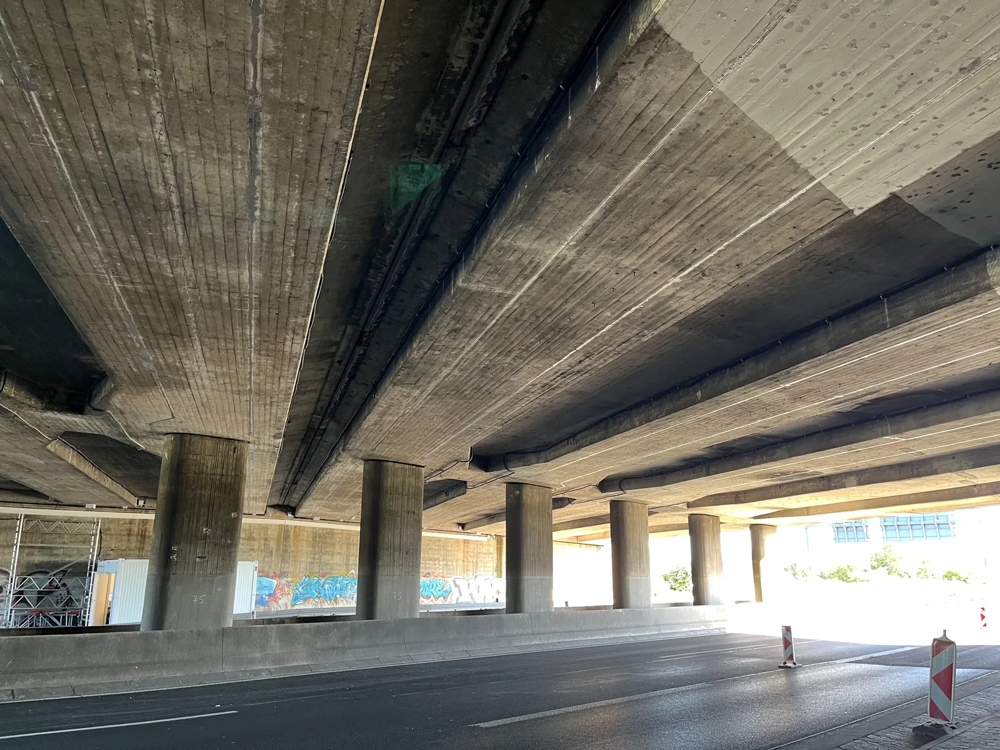

```{=html}
<section class="hero" aria-labelledby="hero-title">
  <div class="hero-copy">
    <div class="eyebrow">Structural Engineer · Researcher · Vancouver</div>
    <h1 id="hero-title">Hi, I'm Guofeng Qian.</h1>
    <p class="intro">I study how structures age, and how measurements and models can tell us about it before it becomes a problem.</p>
    <p>My work combines structural health monitoring, physics-based simulation, and machine learning, from corrosion on U.S. navigation-lock gates to highway bridges in Germany.</p>
    <p class="hero-location">Ph.D., UC San Diego · Formerly R&amp;D Engineer at LPI, Hannover · Now in Vancouver, BC</p>
    <div class="button-row">
      <a class="button" href="work.html">Explore My Work <span aria-hidden="true">→</span></a>
      <a class="button secondary" href="about.html">More About Me <span aria-hidden="true">→</span></a>
    </div>
    <div class="hero-links">
      <a href="mailto:g3qian@gmail.com">Email ↗</a>
      <a href="https://scholar.google.com/citations?user=KxP9bSkAAAAJ&amp;hl=en">Google Scholar ↗</a>
      <a href="https://www.linkedin.com/in/guofeng-qian-a01840207/">LinkedIn ↗</a>
      <a href="files/Guofeng_Qian_CV.pdf">CV ↗</a>
    </div>
  </div>
  <figure class="hero-figure">
    
    <figcaption><span>Beneath one of two twin highway bridges I monitored in Germany.</span></figcaption>
  </figure>
</section>
<section class="home-section first" aria-labelledby="selected-work-title">
  <div class="section-heading">
    <div><div class="section-kicker">Monitoring and Modeling</div><h2 id="selected-work-title">Selected Work</h2></div>
    <a href="work.html">Case Studies and Other Work <span aria-hidden="true">→</span></a>
  </div>
  <p class="section-lead">Five projects, starting with monitoring bridges in service, followed by corrosion modeling, reliability, Bayesian updating, and damage diagnosis.</p>
```



```{=html}
</section>
<section class="home-section" aria-labelledby="practice-title">
  <div class="section-heading"><div><div class="section-kicker">What I Do</div><h2 id="practice-title">Three Questions Behind My Work</h2></div></div>
  <p class="section-lead">Across these projects, in research and in practice, the work comes back to the same three questions.</p>
  <div class="practice-grid">
    <div class="practice-item"><span class="practice-index">01 · Monitor</span><h3>How Is the Structure Behaving?</h3><p>Reading a structure's response through vibration, strain, acoustic emission, and fiber-optic sensing, and separating real change from the effects of temperature and traffic.</p></div>
    <div class="practice-item"><span class="practice-index">02 · Model</span><h3>What Is Happening Inside?</h3><p>Building finite-element and multiphysics models of damage we cannot see directly, then using machine learning so they run fast enough to explore uncertainty.</p></div>
    <div class="practice-item"><span class="practice-index">03 · Decide</span><h3>What Should We Do Next?</h3><p>Combining models and measurements through Bayesian updating and reliability analysis, so that inspection and maintenance choices rest on evidence.</p></div>
  </div>
</section>
<section class="home-section" aria-labelledby="recent-title">
  <div class="section-heading"><div><div class="section-kicker">News</div><h2 id="recent-title">Recently</h2></div><a href="publications.html">All Publications <span aria-hidden="true">→</span></a></div>
  <ul class="recent-list">
    <li><time>2026</time><div><a href="work/bridge-oma-temperature.html">Presented Our Study of Temperature Effects on Bridge Frequencies</a><small>Lead Author · EWSHM 2026, Toulouse</small></div></li>
    <li><time>2026</time><div><a href="publications.html#conf-voi">When Does Structural Monitoring Pay Off?</a><small>Coauthor · EURODYN 2026, Hannover</small></div></li>
    <li><time>2026</time><div><a href="work/corrosion-model-updating.html">Testing a Corrosion Model Against Laboratory Experiments</a><small>Accepted · Journal of Civil Structural Health Monitoring</small></div></li>
    <li><time>2026</time><div><a href="publications.html#book-digital-twin">Digital-Twin Architectures for Inland Waterway Infrastructure</a><small>Book Chapter · Woodhead Publishing</small></div></li>
    <li><time>2025</time><div><a href="publications.html#conf-federated">Best Paper Award for a Federated-Learning Monitoring Framework</a><small>Coauthor · IWSHM 2025, Stanford</small></div></li>
  </ul>
</section>
<section class="contact-band" aria-labelledby="contact-title">
  <div><h2 id="contact-title">Say Hello</h2><p>I'm always glad to talk about structural monitoring, digital twins, or an interesting engineering problem.</p></div>
  <a class="button secondary" href="mailto:g3qian@gmail.com">Get in Touch <span aria-hidden="true">↗</span></a>
</section>
```
