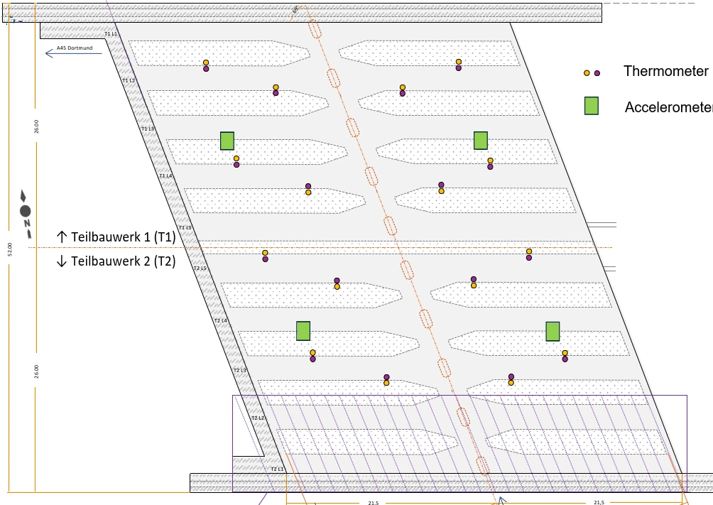
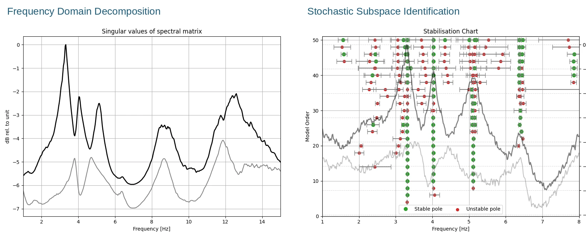
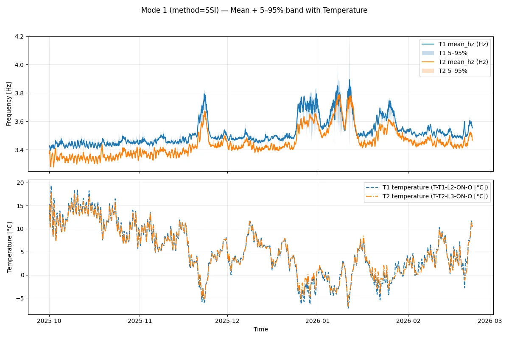
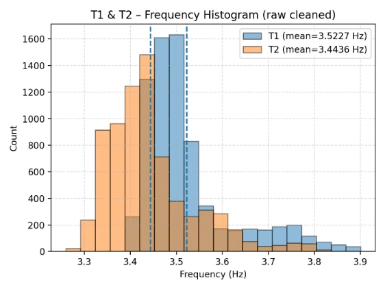
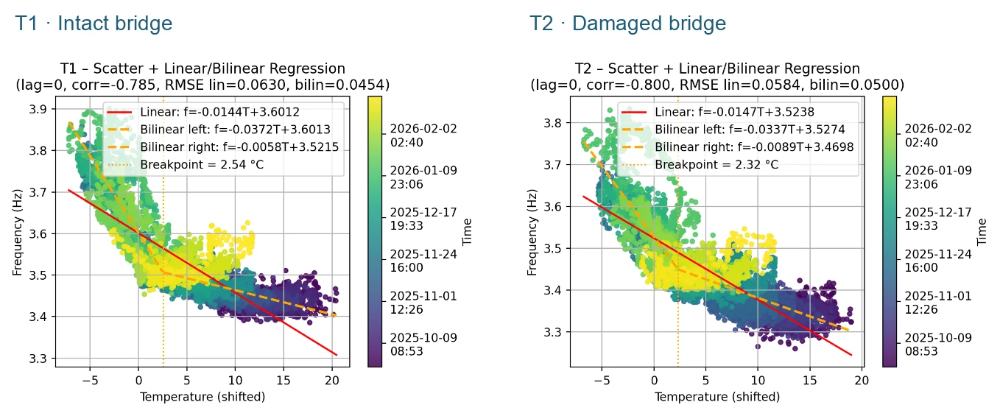

::: {.eyebrow .case-eyebrow}
Engineering Practice · LPI Ingenieurgesellschaft · 2025–2026
:::

::: {.column-page .case-hero}
{fig-alt="Concrete girders beneath a monitored twin highway bridge"}
:::

::: {.lede}
Operational modal analysis measures a bridge's natural frequencies from everyday traffic, without closing it. But temperature moves those frequencies too, often by more than damage would. At LPI, I automated the analysis for two nearly identical highway bridges, one intact and one with tendons broken by a truck impact, and studied how temperature shifts each one's natural frequency.
:::



```{=html}
<div class="stats" aria-label="Key findings">
  <div><span class="stat-number">3.52 / 3.44</span><span class="stat-label">Hz, intact / damaged bridge</span></div>
  <div><span class="stat-number">10–15 min</span><span class="stat-label">of data needed for a reliable estimate</span></div>
  <div><span class="stat-number">2–3 °C</span><span class="stat-label">break in the frequency–temperature relationship</span></div>
</div>
```



## Two Twin Bridges, One with Broken Tendons

Both prestressed-concrete bridges were built in 1966 at the same highway interchange. Later, a truck impact fractured three tendons in the southern bridge; two of its lanes were closed and its asphalt removed. Sharing a design, a site, and the weather, the twins remove many of the usual unknowns.

Each bridge carries two accelerometers sampling at 100 Hz. Temperature sensors embedded in the concrete sample at 1 Hz, so the analysis uses the temperature of the structure itself rather than of the air.

{fig-alt="Sensor layout marking accelerometers and thermometers on the two bridge decks"}

## Operational Modal Analysis, Automated

I automated the identification in Python with two classic methods that cross-check each other. Frequency domain decomposition finds peaks in the singular values of the measured spectra. Stochastic subspace identification fits a state-space model to the measured correlations, and a stabilization chart keeps only modes that remain stable as the model order grows.

::: {.column-page}
{fig-alt="Singular-value spectrum with clear peaks, beside a stabilization chart with columns of stable poles"}
:::

## How Much Data Is Enough?

A study of block lengths from 3 to 60 minutes showed that reliable identification needs at least 10–15 minutes of data, depending on how strongly traffic excites the bridge.

Bootstrap resampling gave a 5th–95th percentile interval that reflects identification uncertainty and frequency variation within each analysis window. The intervals widened in cold weather: on the intact bridge, from 0.020 Hz at higher temperatures to 0.063 Hz at low ones.

{fig-alt="Two bridge-frequency time series with uncertainty bands, above the measured temperature history"}

## The Damaged Bridge Sits Lower

On average, the intact bridge vibrated at 3.52 Hz and the damaged bridge at 3.44 Hz.

That gap means more than it seems. Removing the asphalt made the damaged bridge lighter, which alone should have raised its frequency, so the stiffness loss may be larger than the offset suggests.

{fig-alt="Histograms of the two bridges' first-mode frequencies, with means near 3.52 and 3.44 Hz"}

## The Response Changes Near Freezing

A straight line fits neither bridge. Both follow a bilinear relationship with a breakpoint near 2–3 °C, below which the frequency becomes four to six times more sensitive to temperature. A similar pattern, possibly related to freezing, has been reported for the Z24 benchmark bridge.

Above the break, the damaged bridge was about 1.5 times more sensitive than its twin: −0.0089 versus −0.0058 Hz/°C. How a bridge responds to temperature, not only its frequency, may therefore carry information about its condition.

::: {.column-page}
{fig-alt="Side-by-side measured frequency versus temperature scatter plots with linear and bilinear regression fits"}
:::

## What It Means

Automated operational modal analysis with uncertainty bounds turns continuous vibration data into a reliable record of natural frequencies. Read against the structure's own temperature, it shows both what temperature masks and what it may reveal. For bridges with known tendon damage, the response to temperature looks like a promising condition indicator in its own right.

::: {.case-references}
## Publication

- G. Qian, J.-H. Bartels, C. Tomann, and N. Dieckmann. *Case Study on Temperature Effects on Bridge Frequencies.* EWSHM 2026, Toulouse, France. [Full Citation](../publications.qmd#conf-temperature)
:::

```{=html}
<nav class="case-nav" aria-label="Case studies"><a href="../work.html"><small>Overview</small>← All Case Studies</a><a href="corrosion-simulation.html"><small>Next Case Study</small>Corrosion Simulation →</a></nav>
```
