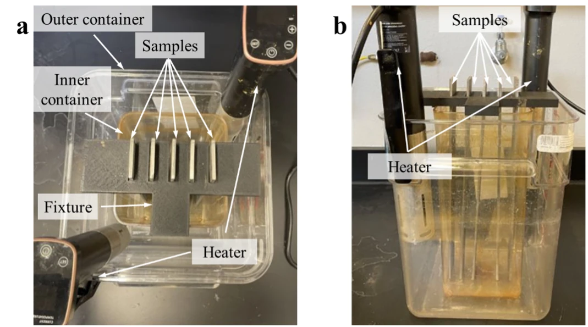
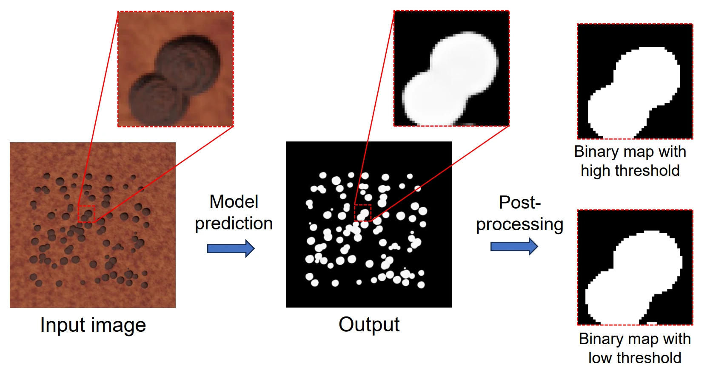
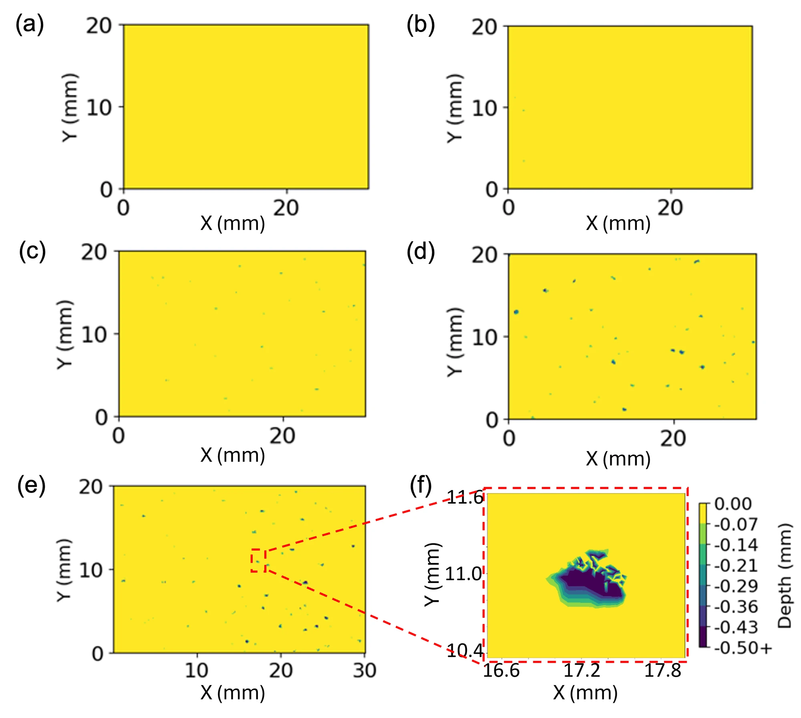
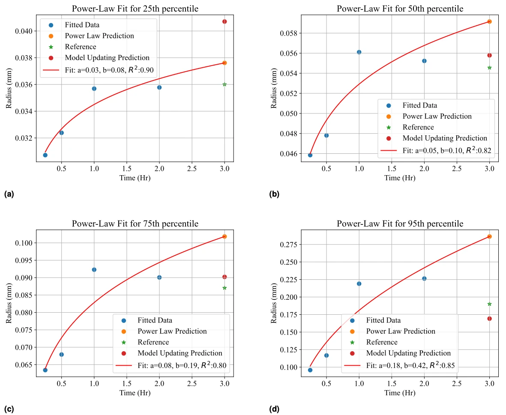

::: {.eyebrow .case-eyebrow}
Doctoral and Postdoctoral Research · UC San Diego with Cal Poly · 2022–2025
:::

::: {.column-page .case-hero .figure-contain}
{fig-alt="Laboratory containers, specimens, fixtures, and heater used for accelerated corrosion experiments"}
:::

::: {.lede}
[The risk map](corrosion-reliability.qmd) depends on assumptions about how pits start and grow. I developed Bayesian methods to update those assumptions in two studies: first using synthetic corrosion images, where the underlying parameters were known, then using real laser scans from accelerated corrosion experiments. Both connect observed pit features to uncertain model parameters and future corrosion.
:::

```{=html}
<div class="glance" role="region" aria-labelledby="glance-title"><h2 id="glance-title">In Brief</h2><dl><dt>What I Did</dt><dd>Developed and benchmarked Bayesian updating on synthetic corrosion images, then applied neural inference to pit-size measurements from real laser scans.</dd><dt>What We Found</dt><dd>Four-second updates in the image-based benchmark. In a separate laboratory study, the 95th-percentile pit-opening radius was underpredicted by 11%, versus a 51% overprediction from a power law.</dd></dl></div>
<div class="stats" aria-label="Key results"><div><span class="stat-number">4 h → 4 s</span><span class="stat-label">per image-based update, after one-time training</span></div><div><span class="stat-number">4–7×</span><span class="stat-label">smaller posterior standard deviations than ABC</span></div><div><span class="stat-number">−11%</span><span class="stat-label">error in the 95th-percentile opening radius; power law: +51%</span></div></div>
<dl class="fact-strip"><div><dt>My Role</dt><dd>Ph.D. and postdoctoral researcher, lead author</dd></div><div><dt>Tools</dt><dd>Blender, U-Net, BayesFlow, laser scanning</dd></div><div><dt>Outputs</dt><dd>SHM 2024; JRUE-B 2025; JCSHM, accepted</dd></div></dl>
```

## Updating from Synthetic Corrosion Images

I first developed and tested the image-based methods using synthetic inspection images rendered in Blender from simulated corrosion. Their known model parameters provided a reference for checking the inference. The observations used for updating were the pit counts and opening sizes extracted from those images.

A U-Net finds the pits, and super-resolution and circle detection measure their openings. A two-stage method called approximate Bayesian computation (ABC) updates the model: pit counts inform how pits start, and opening widths inform how fast they grow. Once updated, the physics predicts pit depth, which the camera cannot see.

::: {.column-page}
{fig-alt="Rendered corrosion image, U-Net segmentation, and postprocessed binary pit masks"}
:::

## Faster Inference for the Image Study

ABC found parameters by rerunning the model again and again, which took hours. I replaced that search with two trained networks: a summary network that condenses the observations, and a conditional invertible neural network that turns them directly into plausible parameter values.

In this synthetic-image benchmark, about five hours of training reduced each update from four hours to four seconds. Posterior standard deviations were roughly four to seven times smaller than with ABC. That speed makes repeated updating practical.

## Updating from Real Laser Scans

I then worked with Duncan Fure and Long Wang at Cal Poly on real corrosion measurements. Stainless-steel specimens were corroded in ferric chloride at 50 °C for 15 minutes to 3 hours, then laser-scanned at 4 µm spacing in the surface plane. I extracted pit-opening radius distributions from these scans for model updating.

{fig-alt="Measured laser-scan pit-depth maps at five accelerated-corrosion exposure times"}

I updated a hybrid model of phase-field pit growth and probabilistic pit initiation using the first four exposure times. A summary network and conditional invertible neural network inferred parameter distributions from the measured pit-size distributions. The three-hour scans were reserved for checking the forecast.

::: {.column-page}
{fig-alt="Summary-network and conditional-invertible-network workflow for updating model parameters from real laser-scan pit-size observations"}
:::

## What the Measurements Tell the Model

The experimental observations concentrated the posterior distributions of the pit-initiation parameters λ and β and the reaction parameter θ₁. The diffusion parameter θ₂ remained broadly distributed, showing that these measurements constrain reaction kinetics more strongly than diffusion under the accelerated-test conditions.

{fig-alt="Four prior and posterior density plots for pit-initiation parameters lambda and beta, reaction parameter theta one, and diffusion parameter theta two, inferred from real laser-scan measurements"}

## Forecasting the Pit-Size Distribution

I propagated these posterior parameter distributions through the model to forecast pit sizes at the held-out three-hour time point. The updated model predicted a 95th-percentile radius of 0.169 mm, against 0.190 mm measured and 0.286 mm from the power law: errors of −11% and +51%, respectively.

The mean pit count was also close: 760 predicted, against 804 observed.

{fig-alt="Pit-opening radius percentile predictions over time comparing the updated corrosion model, a power law, and observations"}

## What It Means

The synthetic-image study established the observation-to-parameter workflow and made inference fast. The laser-scan study carried that workflow into real experiments, from measured pit sizes to posterior parameters and a later-time forecast. Together, they show how repeated observations can refine corrosion predictions.

[View the Model-Updating Code on GitHub ↗](https://github.com/g3qian/hybrid-pitting-corrosion-inference)



```{=html}
<nav class="case-nav" aria-label="Case studies"><a href="corrosion-reliability.html"><small>Previous Case Study</small>← Uncertainty and Reliability</a><a href="generalized-damage-diagnosis.html"><small>Next Case Study</small>Generalized Damage Diagnosis →</a></nav>
```
