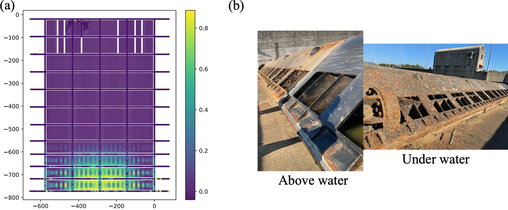
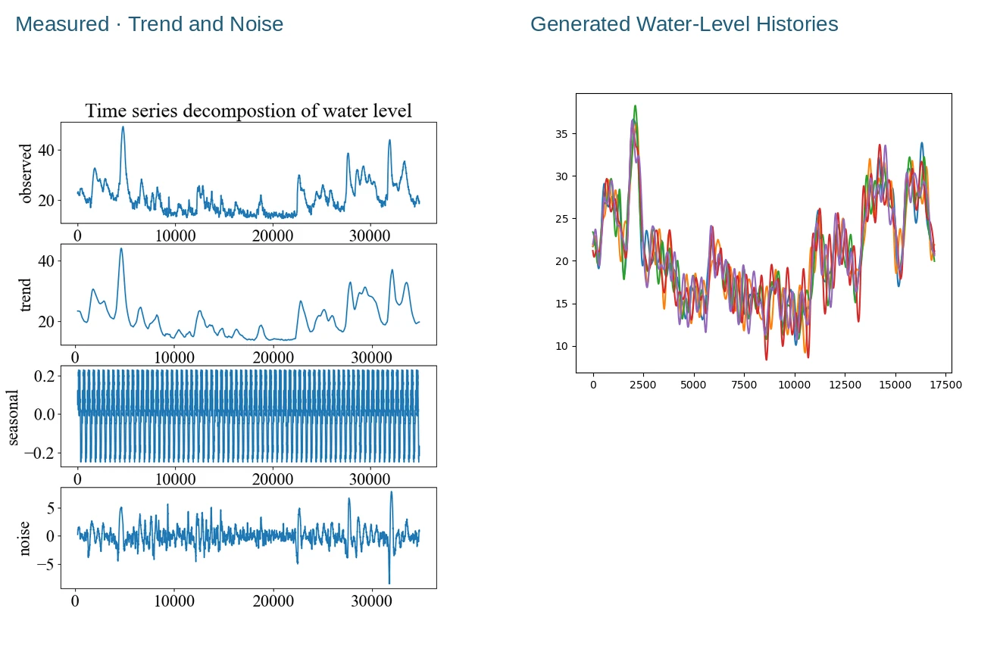
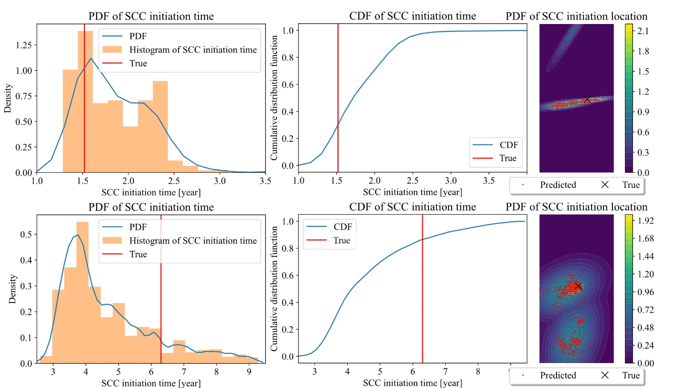
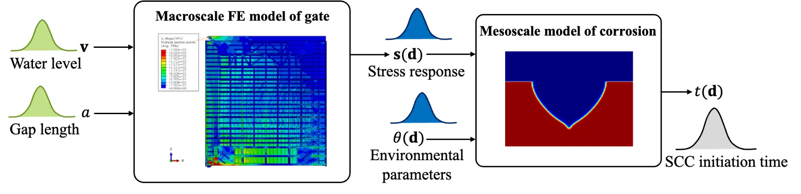
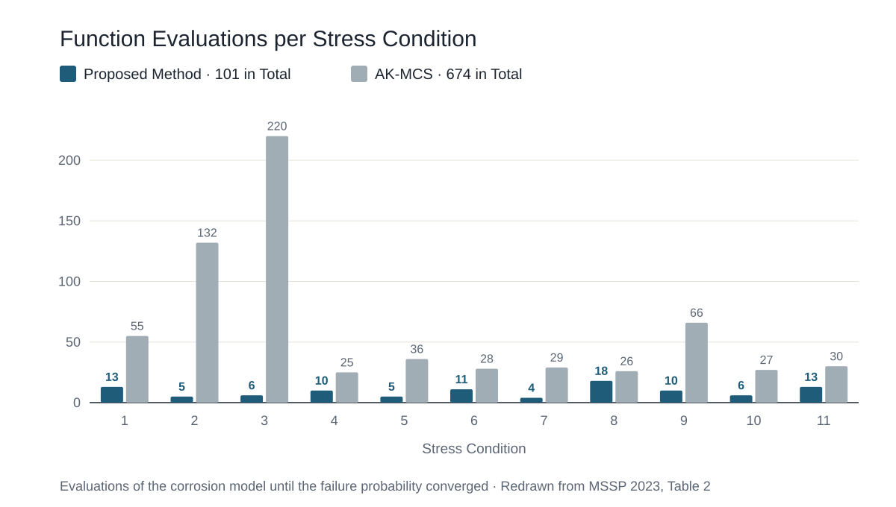

::: {.eyebrow .case-eyebrow}
Doctoral Research · UC San Diego · 2022–2023 · USACE/ERDC
:::

::: {.column-page .case-hero .figure-contain}
{fig-alt="Color-coded crack-initiation probability over the miter gate, highest near the bottom, beside photographs of a corroded retired gate above and below water"}
:::

::: {.lede}
A single simulation answers a "what if" question; an owner deciding where to inspect needs to know how likely a crack is, given everything we do not know. Building on [the fast corrosion model](corrosion-simulation.qmd), I set out to answer that for every location on a steel lock gate, with a manageable number of expensive model runs.
:::

```{=html}
<div class="glance" role="region" aria-labelledby="glance-title"><h2 id="glance-title">In Brief</h2><dl><dt>What I Did</dt><dd>Modeled the uncertain inputs, linked a gate-scale model to the pit-scale model through surrogates, and developed an adaptive method that refines only where it matters.</dd><dt>What We Found</dt><dd>A gate-wide risk map, with the highest probabilities near the bottom. The adaptive local benchmark used 101 evaluations versus 674 for AK-MCS.</dd></dl></div>
<div class="stats" aria-label="Key results"><div><span class="stat-number">6.7×</span><span class="stat-label">fewer evaluations in the local benchmark: 101 vs 674</span></div><div><span class="stat-number">2 scales</span><span class="stat-label">gate model and pit model, linked by stress</span></div><div><span class="stat-number">2 years</span><span class="stat-label">time window for the crack-initiation probability</span></div></div>
<dl class="fact-strip"><div><dt>My Role</dt><dd>Ph.D. researcher, lead author</dd></div><div><dt>Tools</dt><dd>Abaqus, Python, Gaussian processes, importance sampling</dd></div><div><dt>Outputs</dt><dd>MSSP 2023; SEM 2023; book chapter 2026</dd></div></dl>
```

## Where the Uncertainty Comes From

Nothing about a gate in service is fixed. Water levels change with every lock operation, a gap can open where the gate should bear against the wall, and the water's chemistry and temperature change how fast steel corrodes. I gave each of these a probability distribution.

```{=html}
<div class="table-wrap"><table class="data-table"><caption>Sources of uncertainty in the reliability analysis, after MSSP 2023</caption><thead><tr><th scope="col">Variable</th><th scope="col">What Drives It</th><th scope="col">Model</th></tr></thead><tbody><tr><td>Upstream water level</td><td>Waterway elevation management</td><td>Gaussian</td></tr><tr><td>Downstream water level</td><td>Lock operation</td><td>Weibull</td></tr><tr><td>Gap length at the quoin block</td><td>Loss of contact between gate and wall</td><td>Random variable</td></tr><tr><td>Reaction constant</td><td>Water chemistry and temperature</td><td>Gaussian</td></tr><tr><td>Diffusion coefficient</td><td>Water chemistry and temperature</td><td>Gaussian</td></tr></tbody></table></div>
```

To characterize changing loads in the broader simulation study, I used USGS water levels recorded every 15 minutes at Greenup Dam. I separated the record into a trend and random fluctuations, then used a Karhunen–Loève expansion to generate water-level histories. The reliability analysis used the distributions summarized above.

::: {.column-page}
{fig-alt="Decomposition of a measured water-level record into trend, seasonal, and noise components, beside several generated water-level histories"}
:::

## From an Uncertain Pit to a Distribution of Crack Times

The surrogate from the first project carries its own uncertainty. Because it runs in seconds, I could propagate that uncertainty by Monte Carlo simulation: thousands of possible pit histories, each checked against the crack-initiation criterion. The result is not one crack-initiation time but a distribution, together with where on the pit the crack is likely to start.

::: {.column-page}
{fig-alt="Probability density and cumulative distribution of crack-initiation time, and maps of likely crack-initiation location, for two cases"}
:::

## Two Scales, Two Surrogates

Next came the whole gate. A validated, 64,919-element Abaqus model of the Greenup miter gate turns water levels and gap length into local stresses. I ran it 1,000 times and trained a global surrogate on the results; nine features captured 95% of the variation in the gate's strain response.

A second, local surrogate turns those stresses, together with the uncertain corrosion parameters, into the probability that a crack starts within two years.

::: {.column-page}
{fig-alt="Diagram connecting water levels and gap length, a finite-element gate model, local stresses, a mesoscale corrosion model, and crack-initiation time"}
:::

## Spending Simulations Where They Matter

For this reliability calculation, accurate predictions near the boundary between "safe" and "cracked" matter most. I combined importance sampling, Gaussian mixture models, and active learning to add training runs near that boundary, with a stopping rule based on a conservative bound on the probability error.

Across eleven stress conditions, the local benchmark required 101 function evaluations, compared with 674 for adaptive Kriging Monte Carlo simulation (AK-MCS). The benchmark used a Gaussian-process approximation of the phase-field model as its reference model.

::: {.column-page}
{fig-alt="Grouped bar chart of local benchmark function evaluations per stress condition: the proposed method needs 4 to 18 runs, AK-MCS needs 25 to 220"}
:::

## Why Risk Concentrates Low on the Gate

Putting the pieces together gives the map at the top of this page. Risk concentrates near the bottom and below the waterline for two reasons: stresses are highest at the bottom, and steel corrodes faster in water than in air. A similar pattern appears on retired gates.

## What It Means

The analysis turns uncertain loads and corrosion parameters into a spatial forecast that can help prioritize inspections. It also makes the link between assumed conditions and predicted risk explicit. The next step was to [update those corrosion parameters with measurements](corrosion-model-updating.qmd).



```{=html}
<nav class="case-nav" aria-label="Case studies"><a href="corrosion-simulation.html"><small>Previous Case Study</small>← Corrosion Simulation</a><a href="corrosion-model-updating.html"><small>Next Case Study</small>Bayesian Model Updating →</a></nav>
```
