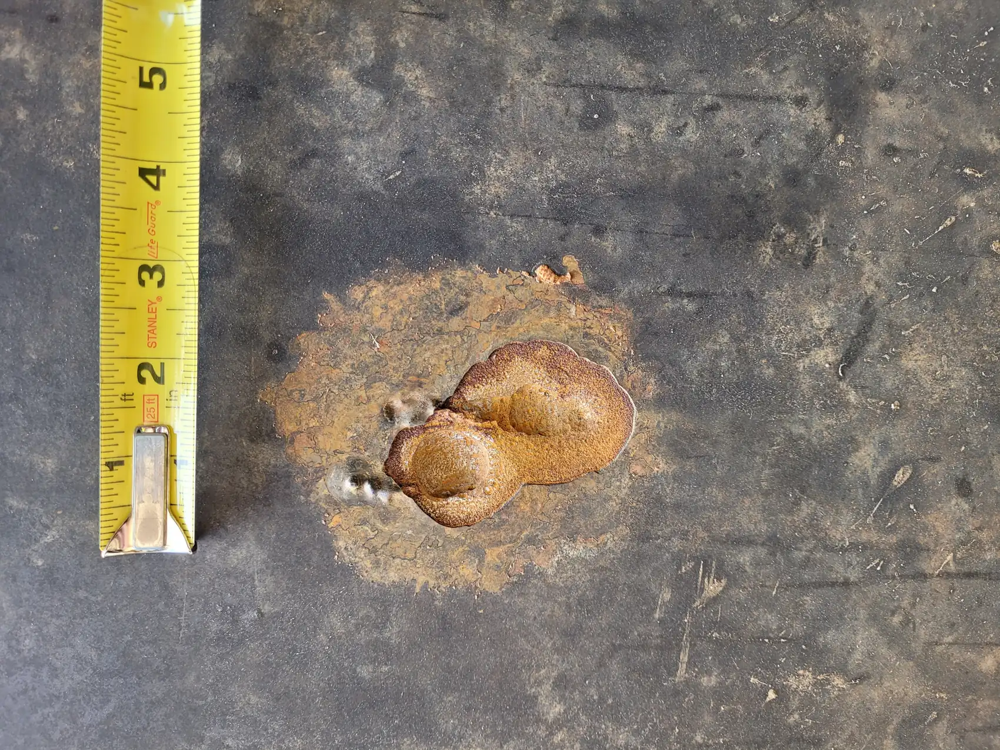
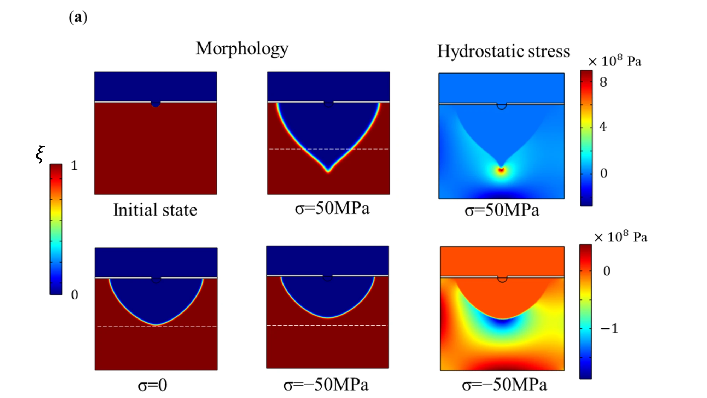
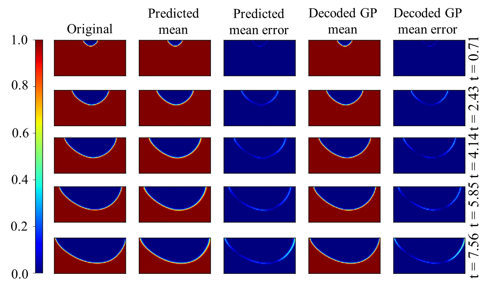
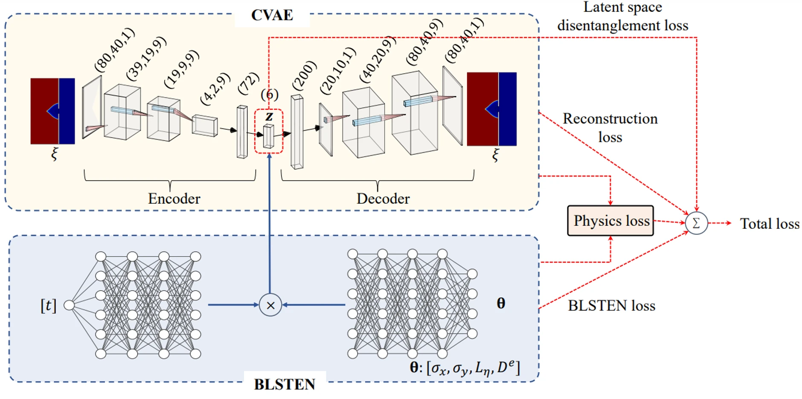

::: {.eyebrow .case-eyebrow}
Doctoral Research · UC San Diego · 2021–2023 · USACE/ERDC
:::

::: {.column-page .case-hero}
{fig-alt="Close view of a corrosion pit in steel beside a measuring tape"}
:::

::: {.lede}
Many of the steel miter gates that keep U.S. river freight moving have served for more than 50 years, and pitting corrosion can quietly turn into cracks. My doctoral research began with two questions: how does a pit grow when the steel around it is under load, and can we simulate that fast enough to use on a real structure?
:::

```{=html}
<div class="glance" role="region" aria-labelledby="glance-title"><h2 id="glance-title">In Brief</h2><dl><dt>What I Did</dt><dd>Built an electro-chemo-mechanical phase-field model, then trained machine-learning surrogates that reproduce it with quantified uncertainty.</dd><dt>What We Found</dt><dd>Tension, compression, and cyclic loading produce clearly different pits, and a 40-minute simulation can be forecast in seconds.</dd></dl></div>
<div class="stats" aria-label="Key results"><div><span class="stat-number">4</span><span class="stat-label">coupled physics: reaction, ion transport, potential, mechanics</span></div><div><span class="stat-number">3,200 → 6</span><span class="stat-label">values needed to describe a corrosion image</span></div><div><span class="stat-number">1.3–5.4 s</span><span class="stat-label">to forecast 200 time steps with trained surrogates</span></div></div>
<dl class="fact-strip"><div><dt>My Role</dt><dd>Ph.D. researcher, lead author</dd></div><div><dt>Tools</dt><dd>COMSOL, Python, TensorFlow, PyTorch</dd></div><div><dt>Outputs</dt><dd>Scientific Reports 2022; MSSP 2023 (coauthor); IWSHM 2023; SEM 2025</dd></div></dl>
```

## A Corrosion Model That Feels Stress

Most corrosion models used in practice are empirical curves fitted to past data, which rarely exist for gates like these. I built one on the physics instead.

The phase-field model couples four sets of equations: the electrochemical reaction at the metal surface, the transport of dissolved ions, the electric potential, and mechanical equilibrium. Because stress enters the reaction kinetics, the model can tell tension from compression, which many earlier phase-field models did not capture.

The results matched physical intuition. Tension makes pits deeper and sharper, compression flattens them, and shear tilts their growth. Cyclic loading also produced crack-like tails in some simulations.

{fig-alt="Phase-field pit shapes and hydrostatic stress fields under tensile, unloaded, and compressive conditions"}

## Stress-Based Crack Initiation

As a pit deepens and sharpens, stress concentrates at its tip. I used the pit depth and tip curvature to estimate this concentration, then proposed a crack-initiation criterion based on whether the local stress reaches the von Mises yield limit.

::: {.figure-compact}
{fig-alt="Simulated sharpened pit beside its stress field, with the highest stress concentrated at the pit tip"}
:::

I compared this stress-based criterion with the Tsujikawa–Kondo criterion, which compares crack and pit growth rates. In the simulated example, the stress-based criterion gives an earlier, more stable initiation prediction: its stress history rises smoothly, while the growth-rate indicator fluctuates.

::: {.figure-compact}
{fig-alt="Comparison of the red von Mises stress curve and blue Tsujikawa–Kondo growth-rate indicator over time, with thresholds and pit-shape insets"}
:::

## A 40-Minute Simulation in Seconds

A physics model this detailed is slow: each run took over 40 minutes. Risk analysis needs thousands of runs, so I built a surrogate.

From 255 simulations, a convolutional autoencoder learned to describe each 80 × 40 corrosion image with just six numbers, where principal component analysis would need hundreds.

I then trained Gaussian-process nonlinear autoregressive models with exogenous inputs (GP-NARX) to forecast those six features. Each prediction uses the previous five time steps together with the applied stress and corrosion parameters. Feeding predictions back into the model gives a longer forecast, with uncertainty, which the decoder turns back into corrosion images.

::: {.figure-compact}
{fig-alt="CNN-GP-NARX workflow showing image encoding, Gaussian-process forecasting using five previous latent-feature steps and physical parameters, recursive prediction, and image decoding"}
:::

::: {.column-page}
{fig-alt="Grid comparing original phase-field corrosion images with surrogate predicted means and errors at five time points"}
:::

## Keeping the Surrogate Physical

To keep long forecasts consistent with continuing material loss, I contributed my phase-field simulations and baseline surrogate to a physics-constrained version. Its loss function penalizes predictions in which corroded material reappears.

The extension reduced mean squared error from 0.0125 to 0.0066. In the published benchmark, forecasting 200 time steps took 1.3 seconds with the extension and 5.4 seconds with the original surrogate, after training.

::: {.column-page}
{fig-alt="Physics-constrained variational-autoencoder and Bayesian forecasting architecture for corrosion morphology"}
:::

## What It Means

The phase-field model explains how load shapes corrosion, and the surrogate makes that physics fast enough to run thousands of times. That speed is what made the next step possible: [carrying uncertainty through the model to a risk map of an entire gate](corrosion-reliability.qmd). Later, I mentored Haiwei Lin in extending the model from crack initiation to crack growth.



```{=html}
<nav class="case-nav" aria-label="Case studies"><a href="bridge-oma-temperature.html"><small>Previous Case Study</small>← Bridge Monitoring</a><a href="corrosion-reliability.html"><small>Next Case Study</small>Uncertainty and Reliability →</a></nav>
```
