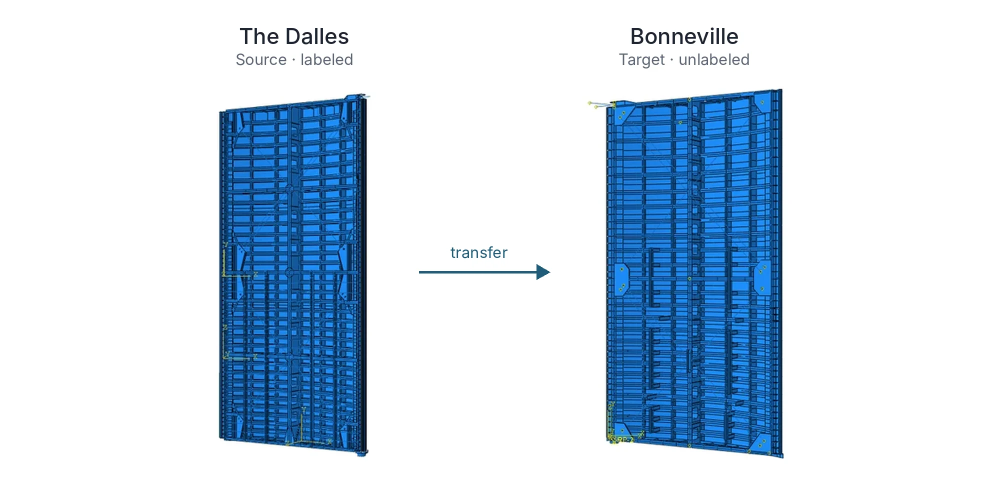
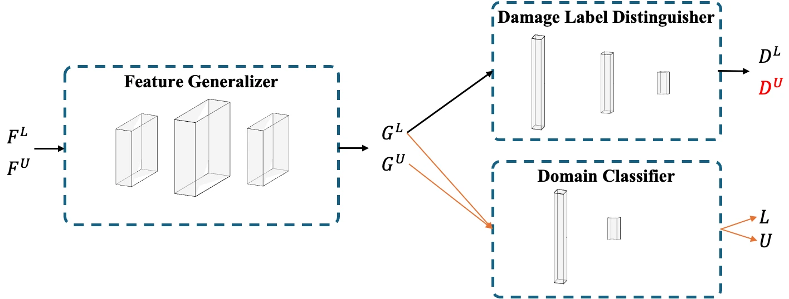
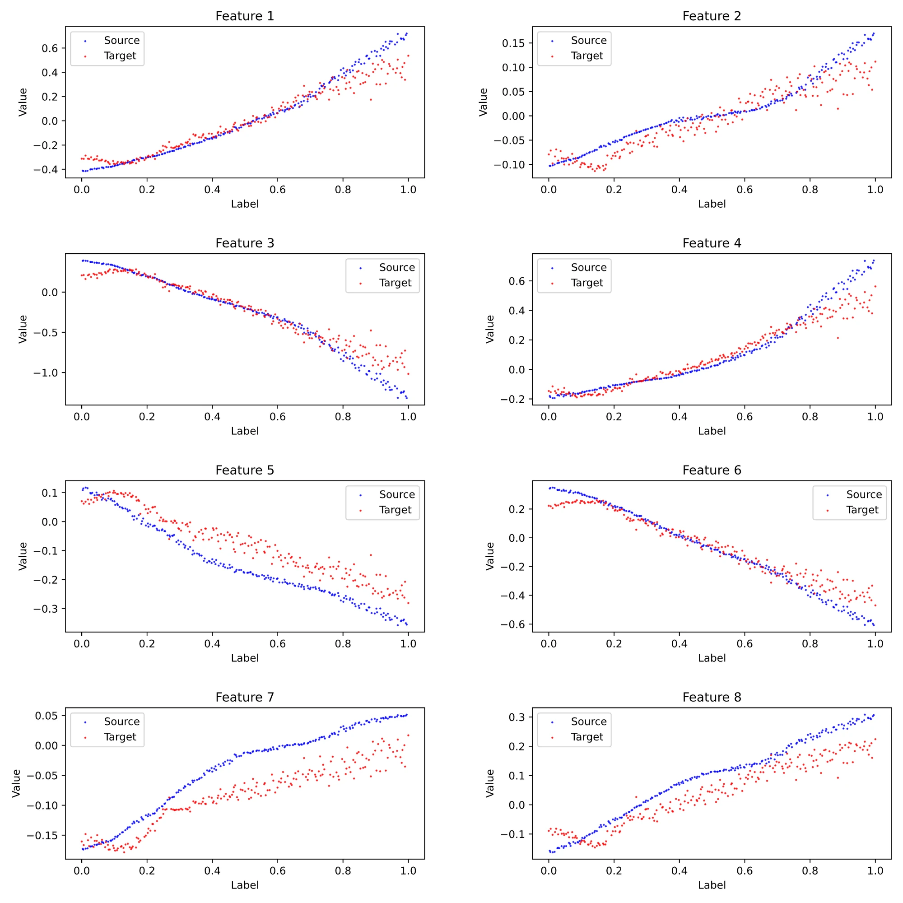
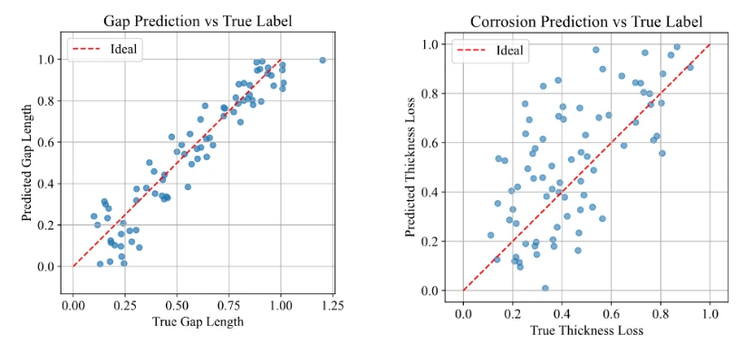

::: {.eyebrow .case-eyebrow}
Postdoctoral Research · UC San Diego · 2024–2025 · USACE/ERDC
:::

::: {.column-page .case-hero .figure-contain}
{fig-alt="Finite-element models of The Dalles source gate and Bonneville target gate, labeled by structure"}
:::

::: {.lede}
The U.S. Army Corps of Engineers manages many similar lock gates, yet labeled damage data are scarce. My postdoctoral work asked whether that similarity could be put to use: can what we know about damage on one structure diagnose another that has no damage labels at all?
:::

```{=html}
<div class="glance" role="region" aria-labelledby="glance-title"><h2 id="glance-title">In Brief</h2><dl><dt>What I Did</dt><dd>Simulated gap and corrosion damage on two gates, selected damage-sensitive sensors, and trained a domain-adversarial network to learn damage features the two gates share.</dd><dt>What We Found</dt><dd>On simulated Bonneville data, gap-prediction error fell by 78%. Corrosion transferred less well, consistent with the larger mismatch between its learned features.</dd></dl></div>
<div class="stats" aria-label="Key results"><div><span class="stat-number">−78%</span><span class="stat-label">gap-prediction error on the unlabeled Bonneville gate</span></div><div><span class="stat-number">0</span><span class="stat-label">target damage labels used for training</span></div><div><span class="stat-number">Best Paper</span><span class="stat-label">IWSHM 2025, related federated-learning work (coauthor)</span></div></div>
<dl class="fact-strip"><div><dt>My Role</dt><dd>Postdoctoral researcher; lead author on the domain-adaptation study, coauthor on three related papers</dd></div><div><dt>Tools</dt><dd>Abaqus, PyTorch, domain-adversarial networks</dd></div><div><dt>Collaboration</dt><dd>USACE ERDC; University of Michigan–Dearborn</dd></div></dl>
```

## Similar, Not Identical

Two gates of the same type still differ in geometry, boundary conditions, and the water levels they hold back, and a network trained on one can mistake those differences for damage.

Domain adaptation aims for a diagnosis that is sensitive to damage but not to which structure the data came from. The labeled structure is the source; the structure to diagnose is the target, which contributes unlabeled responses during training.

## Two Gates on the Columbia River

I tested the idea on validated finite-element models of two downstream miter gates on the Columbia River. The Dalles was the labeled source, and Bonneville was the unlabeled target.

On both, I simulated two common kinds of damage: a gap, where the gate loses contact with the wall at the quoin block, and corrosion, as thickness loss across three zones of the gate. Water levels were sampled within each gate's measured operating range. A sensitivity analysis then picked the strain-gauge locations that respond most to each type of damage.

## Learning What the Gates Have in Common

A domain-adversarial neural network builds this in through a rivalry. A shared feature generator feeds two heads. One predicts the damage, using labels from the source gate only. The other tries to tell which gate the data came from. Training rewards features that help the first head and defeat the second, so the features keep what reveals damage and drop what reveals the structure.

{fig-alt="Diagram of a domain-adversarial network: feature generator feeding a damage label predictor and a domain classifier"}

After training, the learned features of the two gates line up: for the same amount of damage, both gates produce similar feature values.

{fig-alt="Eight panels of learned feature values versus damage label, with source and target points largely overlapping"}

## Results on the Unlabeled Gate

On the simulated Bonneville test data, mean squared error for gap size fell from 0.069 to 0.015, a 78% reduction from the source-only baseline. Corrosion error fell from 0.221 to 0.114. Target damage labels were used to evaluate predictions after training.

A statistical check helps explain the difference. Domain adaptation assumes that damage relates to learned features similarly on both gates. Squared conditional maximum mean discrepancy (CMMD²), a measure of that mismatch, was smaller for gaps than for corrosion: 1.37 versus 12.53. Corrosion produced more structure-specific strain responses.

{fig-alt="Predicted versus true damage values on the target gate: gap length points lie close to the ideal line, corrosion thickness loss points scatter widely"}

## A Different Route: Federated Learning

Domain adaptation moves knowledge from a labeled structure to an unlabeled one. Federated learning addresses a different situation: several structures each have data, but the data cannot be pooled because of ownership, privacy, or communication cost.

In a framework led by Yichao Yang, each gate trains a model locally and shares only model updates, never raw measurements. On three variants of the Greenup finite-element model, it estimated loss-of-contact damage about as accurately as centralized training. The paper received the Best Paper award at IWSHM 2025.

## Related Work with the Team

As a coauthor, I also contributed to work led by Yichao Zeng that translates measurements from similar gates into a common domain, then estimates damage with uncertainty through Bayesian inference and model averaging.

## What It Means

Together, these studies move damage diagnosis from a single, well-studied structure toward a population of similar ones, which is the situation most owners actually face. Transfer works best when damage affects both structures in a similar way, and a statistical check can show where it falls short.



```{=html}
<nav class="case-nav" aria-label="Case studies"><a href="corrosion-model-updating.html"><small>Previous Case Study</small>← Bayesian Model Updating</a><a href="../work.html"><small>Overview</small>All Case Studies →</a></nav>
```
