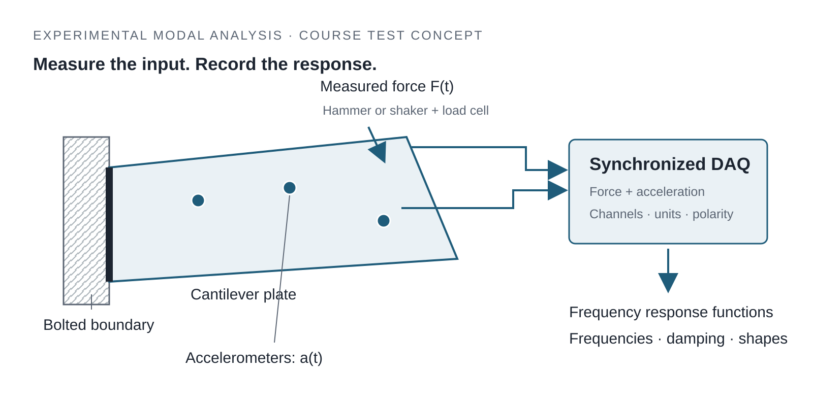
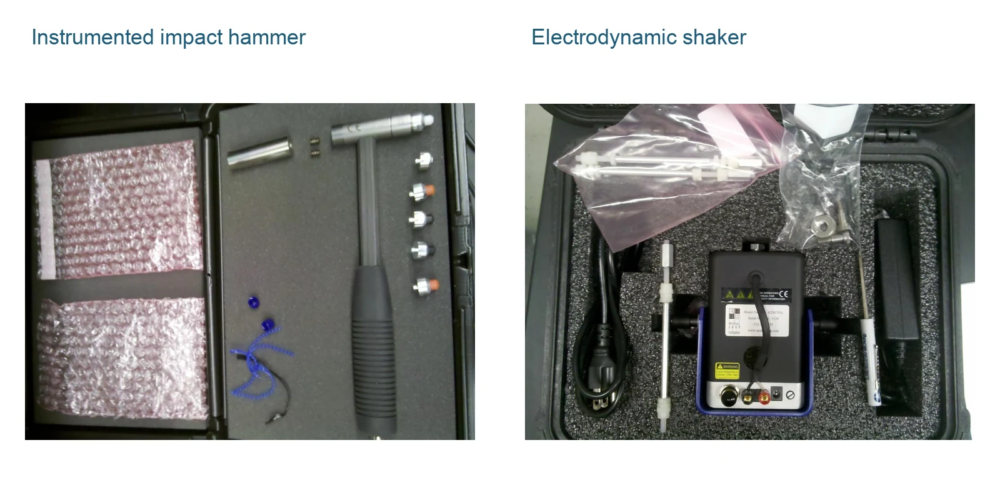

::: {.eyebrow .case-eyebrow}
Teaching · UC San Diego · Spring 2022 and 2023 · SE 168/268
:::

::: {.column-page .case-hero .figure-contain}
{fig-alt="Cantilever plate with illustrative accelerometer locations and a measured hammer or shaker force, connected to synchronized data acquisition and modal analysis"}
:::

::: {.lede}
A vibration model is only useful if it represents the hardware. As teaching assistant for *Structural System Testing and Model Correlation*, I mainly led the experimental sessions, helping students turn a cantilever-plate model into a working modal test. The course carried the same structure through prediction, measurement, and model updating, so each stage had to support the next.
:::

```{=html}
<div class="glance" role="region" aria-labelledby="glance-title"><h2 id="glance-title">In Brief</h2><dl><dt>What I Did</dt><dd>Led hands-on sessions in instrumentation, impact-hammer and shaker testing, data acquisition, and measurement-quality checks; guided the connection between test data and modal models.</dd><dt>What the Course Connected</dt><dd>Pre-test modeling and sensor selection, measured force–response data, identified vibration modes, and an updated model tested against a later structural change.</dd></dl></div>
<div class="stats" aria-label="Course structure"><div><span class="stat-number">10 weeks</span><span class="stat-label">from pre-test analysis to model updating</span></div><div><span class="stat-number">2 methods</span><span class="stat-label">impact-hammer and shaker excitation</span></div><div><span class="stat-number">12 locations</span><span class="stat-label">selected in the pre-test measurement plan</span></div></div>
<dl class="fact-strip"><div><dt>My Role</dt><dd>Teaching assistant; experimental-session lead</dd></div><div><dt>Tools</dt><dd>MATLAB, NI DAQ / seDAQ, IMAT, OPoly</dd></div><div><dt>Course</dt><dd>SE 168/268 · Prof. Michael Todd and ATA Engineering</dd></div></dl>
```

## One Structure, Three Connected Stages

The course followed a bolted cantilever plate throughout. Students first predicted its vibration, then measured it, and finally reconciled the model with the test. This made the purpose of each exercise concrete: a sensor location, sampling choice, or boundary assumption could affect the final correlation.

::: {.course-sequence}
1. **Pre-Test** — predict modes, select measurement locations, and plan the test.
2. **Test** — apply a measured force, record responses, and check the data.
3. **Post-Test** — identify modes, correlate the model, and investigate a structural change.
:::

## Planning a Test the Model Can Explain

The early labs built mass, stiffness, and damping models, then moved to a finite-element model of the plate. Target modes and their shapes guided the choice of measurement locations. Guyan reduction connected the many model degrees of freedom to the smaller set available for measurement.

That preparation came into the lab. The target frequency band guided the sampling rate, hammer-tip selection, and excitation settings; the decay time helped set the record length. Channel locations, measurement directions, and units had to agree with the model.

## Leading the Vibration Tests

I led the experiment sessions around two ways of exciting the same plate. For impact testing, I guided students through hammer-tip selection, a clean single hit, and repeated measurements. A double hit or an overloaded channel needed attention while the setup was still available.

For shaker testing, I guided band-limited random excitation and the acquisition setup. The load cell measured the applied force, while accelerometers measured the response. Comparing hammer and shaker measurements helped students connect excitation bandwidth, repeatability, and signal quality to the frequency range they wanted to identify.

{fig-alt="Course equipment photographs of an instrumented impact hammer with interchangeable tips and an electrodynamic shaker"}

## Checking Data Before Leaving the Lab

I emphasized checking channel definitions, sensitivity settings, polarity, and signal levels before accepting a record. We inspected time histories for double hits, clipping, and incomplete decay, then checked whether the force spectrum covered the target modes.

Frequency response functions (FRFs) relate measured acceleration to applied force. Coherence and reciprocity provided further checks on the measurements and channel definitions. A weak response or poor coherence prompted investigation of the excitation, sensor location, and processing choices.

## Turning Measurements into Modes

The post-test labs used MATLAB to estimate auto- and cross-spectra, FRFs, and coherence, with averaging and windowing suited to the excitation. Students compared impact and shaker results before choosing the data for modal identification.

In IMAT/OPoly, they extracted natural frequencies, damping, and mode shapes, checked stable poles, and compared reconstructed FRFs with the measurements. The sequence separated the quality of the recorded data from the quality of the fitted modal model.

## Correlating the Model and Identifying a Change

The final stage compared test and model frequencies, mode shapes, and FRFs. Mode matching, modal assurance, and cross-orthogonality helped establish which modes could be compared. Model updating then adjusted uncertain plate and boundary stiffnesses, rather than assuming the bolted edge was perfectly fixed.

::: {.column-page}
{fig-alt="Experimental FRFs and modes compared with finite-element predictions, feeding a loop that updates uncertain plate and boundary stiffness parameters"}
:::

The final project introduced an added spring at an unknown location. Students used a new measurement set and their correlated baseline model to estimate its location and stiffness, then explain their reasoning across the full test-and-analysis process.

## What It Means

My main contribution was making the experimental stage work: connecting instrumentation and excitation choices to trustworthy measurements, then helping students use those measurements in a dynamic model. These experimental modal-analysis skills carry across structural, mechanical, and aerospace testing: plan the test, troubleshoot at the bench, and explain the agreement or discrepancy with analysis.

::: {.case-references}
## Course Context

SE 168/268, *Structural System Testing and Model Correlation*, UC San Diego. Co-taught by Prof. Michael Todd and engineers from ATA Engineering. Teaching assistant, Spring 2022 and 2023. [UC San Diego Course Catalog ↗](https://catalog.ucsd.edu/courses/SE.html)
:::

```{=html}
<nav class="case-nav" aria-label="Case studies"><a href="bridge-oma-temperature.html"><small>Previous Case Study</small>← Bridge Monitoring</a><a href="corrosion-simulation.html"><small>Next Case Study</small>Corrosion Simulation →</a></nav>
```
